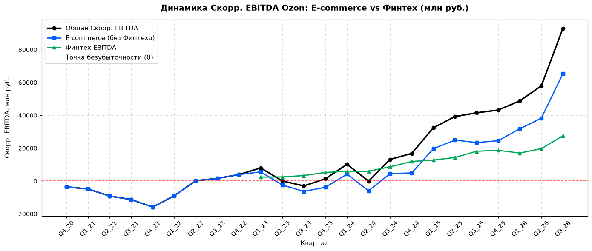
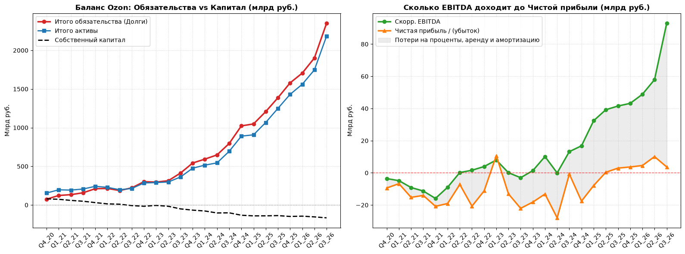
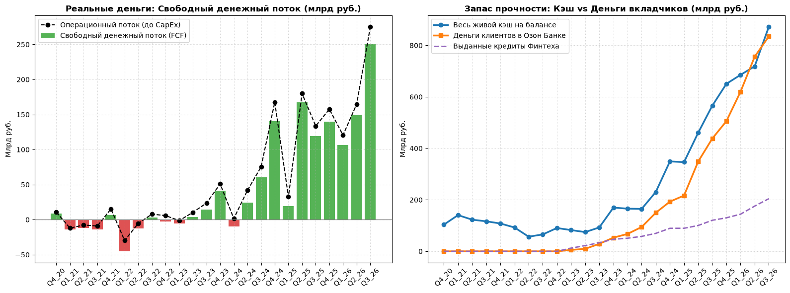

# Финансовый и операционный анализ Ozon (Q4 2020 – Q3 2026)

Аналитическое исследование бизнес-модели экосистемы Ozon на основе квартального датабука (24 квартала): от стадии инвестиционных убытков до выхода в устойчивую чистую прибыль и масштабирования Финтеха.

## Инструменты
* **Python** (`pandas`, `matplotlib`, `openpyxl`)
* **Excel / Power Query** (первичная трансформация и проверка данных)
* **Jupyter Notebook**

---

## Ключевые выводы и визуализация

### 1. Синергия E-commerce и Финтеха («эффект маховика»)

* **Масштабирование маркетплейса:** оборот (GMV) за 6 лет вырос более чем в 20 раз (до 1,56 трлн руб. в Q3 2026).
* **Роль Финтеха:** точка **Q1 2023** стала переломной — на графике появляется зелёная линия Финтеха, которая сразу уходит в плюс. Пока основной бизнес (синяя линия) полтора года настраивался и тратил деньги на команды, зарплаты и логистику (уходя в минус в Q3 2023 и Q2 2024), именно Финтех страховал компанию и вытягивал общую прибыль.
* **Взаимный разгон:** после 1,5 лет настройки, начиная с **Q3 2024**, обе линии резко идут вверх. Финтех подтолкнул оборот маркетплейса, а за счёт огромного потока покупателей и продавцов сам получил объёмы, в разы превышающие показатели до запуска банка.

### 2. Обратная сторона роста: баланс и качество прибыли

* **Отрицательный собственный капитал (график слева):** начиная с **Q3 2022** красная линия обязательств обогнала синюю линию активов, и собственный капитал ушёл в минус (до `-166,5 млрд руб.` в Q3 2026). Компания масштабируется за счёт заёмных и оборотных средств, а не за счёт накопленного капитала.
* **Разрыв между EBITDA и Чистой прибылью (график справа):** при рекордной Скорр. EBITDA в 93,0 млрд руб. (Q3 2026) до чистой прибыли доходит лишь 3,7 млрд руб. (~4%). По графику видно, что почти весь операционный заработок (серая зона) уходит на расходы ниже уровня EBITDA, оставляя чистую прибыль прижатой к нулю.

### 3. Денежный поток (FCF) и ликвидность Финтеха

* **Зависимость от темпов оборота (график слева):** зелёные столбики свободного денежного потока растут за счёт того, что покупатели платят за заказы сразу, а продавцам деньги переводятся через 2–3 недели. Провалы каждый первый квартал (`Q1`) показывают обратную сторону этой модели: как только после новогодних распродаж продажи падают, а старые долги селлерам нужно отдавать, денежный поток резко уходит в минус. **Вывод:** кэш генерируется, только пока оборот постоянно растёт.
* **Минимальный запас свободных денег (график справа):** весь живой кэш на балансе (872,1 млрд руб. в Q3 2026) почти равен деньгам клиентов на счетах и вкладах в Озон Банке (834,8 млрд руб.), а в **Q2 2026** деньги вкладчиков даже временно превысили общий остаток на счетах. **Вывод:** собственных свободных денег у компании немного (около 37 млрд руб. сверх обязательств перед клиентами банка), но при этом банк ведёт себя осторожно и выдаёт в кредиты меньше четверти привлечённых средств (204,3 млрд руб.).

## Главный итог исследования
Ozon построил мощный «маховик», где маркетплейс и Финтех усиливают друг друга и генерируют рекордную операционную прибыль. Однако из-за отрицательного собственного капитала и высокой доли заёмных и клиентских средств в балансе устойчивость всей модели напрямую зависит от непрерывного роста оборота.

---

## Файлы в репозитории
* `ozon.ipynb` — Jupyter Notebook с кодом обработки данных, расчётами и графиками.
* `ozon_databook_clean.xlsx` — очищенный и структурированный датасет (24 квартала × 29 метрик).
* `Ozon_Databook_Q3_26.xlsx` — исходный датабук компании.
